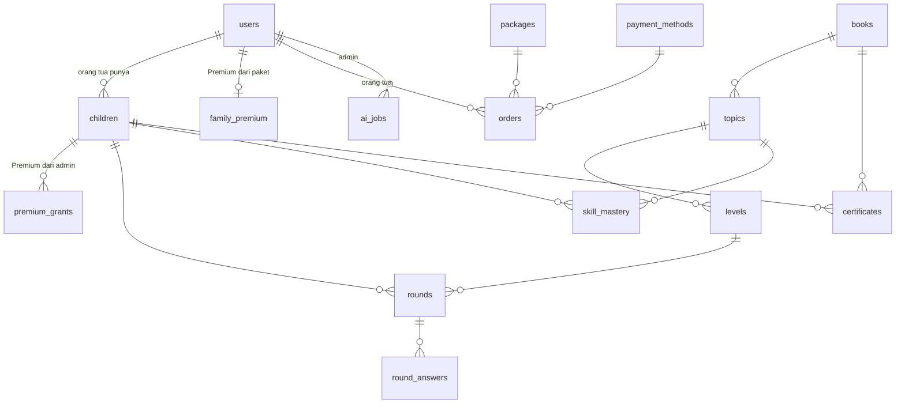

# PRD: UdaKids

Versi 1.2 · 16 Oktober 2026 · Penyusun: Ridho Dwi Syahputra

Nama produk dan maskot ditulis sekali di `apps/web/src/config/app.ts` (`APP_NAME`, `CHARACTER_NAME`).

## 1. Ringkasan

UdaKids adalah aplikasi web belajar untuk anak SD Kelas 1 sampai 4. Anak berlatih soal Matematika dan Sains per topik dan
per level, ditemani robot kecil bernama Momo yang membacakan soal. Orang tua membuat profil anak, memantau laporan, membeli
paket, dan mengunduh sertifikat anak. Admin mengelola buku, topik, level, keluarga, transaksi, Premium, sertifikat, dan
pengaturan aplikasi (level gratis, kontak WhatsApp, isi lembar sertifikat), dibantu asisten AI untuk draf materi. Papan
peringkat hanya menampilkan nama panggilan.

Rilis 1.0 memuat **5 buku**: Matematika Kelas 1, 2, 3, 4 dan Sains Kelas 1. Totalnya 50 topik dan 199 level, semua soal
dibuat generator. Tiga peran (anak, orang tua, admin) saling terhubung penuh. Arsitekturnya monorepo pnpm, React + Vite,
NestJS, Drizzle, PostgreSQL, dan paket `engine` bersama yang dipakai web dan server.

**Posisi saat ini:** seluruh tampilan tiga peran sudah berjalan dengan data tiruan di browser (mode mock, M1 sampai M5 dan
tambahannya selesai). API NestJS dan database dibangun di M6 sampai M11 dengan kontrak yang sama (bagian 12).

## 2. Target User

- Siapa: anak usia 6 sampai 10 tahun (Kelas 1 sampai 4 SD), termasuk yang belum lancar membaca, dan orang tuanya.
- Jenis user:
  - **Anak:** bermain ronde latihan, melihat Peta Belajar, tanaman, peringkat, profil, dan sertifikat. Tidak punya email
    dan tidak punya kata sandi tertulis. Akun anak dibuat oleh orang tua.
  - **Orang tua:** mendaftar, membuat profil anak, memantau laporan, membeli paket, mengunduh dan mencetak sertifikat.
  - **Admin:** staf yang mengelola konten, keluarga, transaksi, Premium, sertifikat, dan pengaturan. Akun admin pertama
    dibuat oleh seed, bukan pendaftaran; admin lain ditambahkan admin di menu Staf. Satu peran admin, tanpa tingkatan.
  - **Pengunjung:** melihat landing, paket, contoh sertifikat, dan 10 besar peringkat, serta mengecek keaslian nomor
    sertifikat.

## 3. Masalah yang Diselesaikan

- Anak kelas awal belum lancar membaca, sedangkan banyak platform soal memakai teks panjang, iklan, dan kata "salah" yang
  membuat anak enggan mencoba.
- Orang tua tidak tahu anaknya kuat atau lemah di topik mana.
- Menulis ratusan soal satu per satu lambat dan cepat membosankan; anak butuh soal yang selalu segar dan sesuai level.
- Akses level berbayar harus terkendali tanpa payment gateway (transfer manual, admin yang memeriksa).
- Anak dan orang tua butuh penanda pencapaian yang nyata saat sebuah buku tuntas, dan sertifikatnya harus tampak resmi
  walau nama panggilan anak pendek.
- Aturan bisnis (batas level gratis, nomor WhatsApp, isi lembar sertifikat) berubah-ubah, jadi admin harus bisa mengubahnya
  tanpa menunggu rilis baru.

## 4. Fitur Rilis 1.0 (10 fitur inti)

| No | Fitur                    | Penjelasan singkat |
| -- | ------------------------ | ------------------ |
| 1  | Akun dan tiga peran      | Orang tua daftar (email + kata sandi, wajib centang persetujuan) dan mendapat kode keluarga 6 huruf. Orang tua membuat maksimal 3 profil anak (nama panggilan, warna Momo, sandi 3 gambar). Anak masuk dengan kode keluarga + sandi gambar. Admin masuk lewat halaman staf. Orang tua punya halaman akun (nama, kata sandi, email dengan kode konfirmasi). |
| 2  | Belajar terstruktur      | 5 buku, 10 topik per buku, 4 level per topik (topik pertama Sains Kelas 1 berisi 3 level). Semua topik terbuka sejak awal; di dalam topik level berurutan. Awalnya level 1 dan 2 gratis, level 3 dan 4 Premium; batasnya diatur admin di Pengaturan. Beranda anak berupa **Peta Belajar**: pilihan Kelas 1 sampai 4, jalur topik per buku, dan panel topik (pengantar yang bisa didengar, "Tahukah kamu?", kemajuan, Mulai belajar). Kartu Premium muncul setelah level gratis topik itu lulus. |
| 3  | Ronde latihan            | 10 soal dibuat generator di `engine` dari seed ronde (deterministik, tanpa bank soal statis). Jenis soal: pilihan ganda, isian angka, benar/belum tepat. Pilihan langsung dinilai saat diketuk; isian angka memakai `Keypad` dan tombol periksa. Umpan balik hijau/kuning dengan petunjuk langsung dibacakan, stopwatch tanpa batas, 10 titik indikator, lalu halaman hasil. **Dinilai di server.** |
| 4  | Skor Jago dan tanaman    | Skor penguasaan per topik (0 sampai 100), diperbarui tiap jawaban. Anak hanya melihat tanaman 4 tahap (benih, tunas, pohon, berbuah). Orang tua dan admin melihat angka dan status (Belajar, Bisa, Jago). |
| 5  | Papan peringkat          | Tiga mode: Rata-rata (tertimbang), Total Skor, dan Mock Test (disiapkan, belum berisi). Total dan per buku. Hanya nama panggilan dan warna Momo yang terlihat. Posisi anak sendiri disorot. 10 besar tampil di landing. |
| 6  | Laporan orang tua        | Dasbor keluarga (ringkasan minggu, progres tiap anak dan tiap buku, level berikutnya, topik terkuat dan yang perlu ditemani), laporan per anak, dan kartu sertifikat. |
| 7  | Paket dan pembayaran     | 5 paket: Tunas (30 hari), Kumbang (90), Tumbuh Bersama (180), Bintang Kecil (365), Teman Setia (selamanya). Orang tua memilih paket dan cara bayar (BCA, BNI, CIMB Niaga, Gopay, ShopeePay), mentransfer total dengan kode unik Rp1 sampai Rp499, lalu mengunggah bukti. Admin menyetujui atau menolak dengan catatan. Premium berlaku untuk semua anak di keluarga itu. Tanpa perpanjangan otomatis. Tombol WhatsApp admin di semua halaman. Paket dan rekening bisa ditambah, diubah, dinonaktifkan, atau dihapus admin; harga di landing dan area orang tua mengikuti menu Paket, dan nomor WhatsApp mengikuti Pengaturan. |
| 8  | Panel admin              | Ringkasan bergrafik; **Konten** (buku, topik, materi, "Tahukah kamu?", judul level, pengecualian gratis/Premium per level); pratinjau soal generator; asisten AI (Gemini) untuk draf materi dan kurikulum; **Keluarga** (cari, saring, urutkan, nonaktifkan akun, atur ulang sandi gambar dan kata sandi, Premium per anak); **Staf**; **Laporan** (statistik level dan laporan per anak); **Transaksi**, **Paket**, dan **Rekening**; **Sertifikat**; **Pengaturan**; dan lonceng notifikasi (pendaftaran, pesanan, bukti, sertifikat). Aturan Pengaturan di bagian 4.3. |
| 9  | Sertifikat Juara Digital | Bagian dari Premium. Anak yang lulus semua level dalam satu buku mendapat sertifikat bernomor (`CERT-XXXXXX`) yang terbit otomatis. Anak melihat dan mencetaknya; orang tua mengunduh gambar PNG atau mencetak/menyimpan PDF dan bisa mengisi nama lengkap anak khusus untuk sertifikat; admin mengelola desain, isi lembar, daftar menunggu, dan semua sertifikat. Setiap lembar punya kode QR ke halaman publik cek keaslian. Aturan lengkap di bagian 4.2. |
| 10 | Suara                    | Setiap halaman anak membacakan isinya begitu tampil, tombol dan tautan menyebut namanya saat diketuk, soal dan umpan balik dibacakan tanpa jeda. Mode tiruan memakai suara peramban berbahasa Indonesia. M10 menambah klip Google Cloud Text-to-Speech (`id-ID-Chirp3-HD-Leda`) untuk soal dan materi, dibuat sekali dan disimpan di PostgreSQL. Tanpa suara, teks tetap tampil. |

### 4.1 Aturan nilai

- **Ronde:** 10 soal, tiap soal dinilai sekali. Skor = benar / 10 × 100. Lulus bila skor ≥ 70 **dan** keliru ≤ 3.
  Ambang, jumlah soal per ronde, dan batas keliru disimpan per level.
- **Level:** semua topik boleh dipilih bebas. Di dalam topik, level 1 selalu terbuka dan level berikutnya terbuka bila
  level sebelumnya pernah lulus.
- **Premium:** level berbayar hanya bisa dimainkan bila anak punya Premium aktif, dari paket keluarga atau dari admin.
  Level gratis: nomor level ≤ `freeLevels` di Pengaturan (awalnya 2, nilai awal `FREE_LEVELS` di `engine`), kecuali
  admin mengecualikan satu level di menu Konten (level 1 selalu gratis). Kunci berbayar bisa dimatikan: semua level
  gratis. Yang berlaku adalah tanggal berakhir Premium yang paling akhir. Dicek di server.
- **Skor Jago:** tahap tanaman yang sudah terlihat tidak pernah turun. Kekeliruan di mode tantangan tidak menghukum.
- **Peringkat:** total skor = jumlah skor terbaik tiap level, seri dipecah dengan total waktu lebih cepat. Mode Rata-rata
  memakai rata-rata tertimbang dengan 5 ronde awal bernilai 70.

### 4.2 Aturan Sertifikat Juara Digital

- **Syarat:** semua level dalam satu buku pernah lulus dan Premium aktif. Satu anak mendapat paling banyak satu sertifikat
  per buku. Buku tanpa level tidak menghasilkan sertifikat.
- **Terbit otomatis:** saat ronde yang menuntaskan buku itu lulus, server langsung menerbitkan sertifikat (cara terbit
  `auto`) dan halaman hasil merayakannya dengan tombol "Lihat sertifikat".
- **Tertunda:** bila buku tuntas ketika Premium tidak aktif, statusnya "Perlu Premium". Anak melihat ajakan meminta orang
  tua (tanpa harga), orang tua melihat tombol Lihat paket. Setelah Premium aktif, anak menekan "Ambil sertifikatku" atau
  orang tua menekan "Terbitkan sekarang" (cara terbit `claim`). Admin bisa menerbitkannya langsung dari daftar Menunggu,
  walau Premium tidak aktif (cara terbit `admin`).
- **Nomor:** `CERT-` diikuti 6 karakter dari `ABCDEFGHJKLMNPQRSTUVWXYZ23456789` (tanpa I, O, 0, dan 1 agar tidak
  tertukar), dibuat dari sumber acak dan dijamin unik.
- **Isi lembar (A4 mendatar):** kepala (penerbit dan kalimat kecil), judul dan sub-judul, nama di sertifikat, kalimat
  pujian usaha ("atas ketekunannya berlatih dan menyelesaikan seluruh 40 level di 10 topik buku"), judul buku, baris
  keterangan (kurikulum dan rata-rata skor, bila diaktifkan), stempel JUARA, dua penanda tangan, kode QR, tanggal
  terbit, dan nomor sertifikat. Teks tetap lembar (penerbit, judul, penanda tangan, kurikulum, tampil/sembunyi skor dan
  QR) dari Pengaturan, bukan tertulis di kode; awalnya "UdaKids · Belajar bersama Momo", "SERTIFIKAT Juara Digital", Momo
  (Teman Belajar) dan Tim UdaKids (Pengelola). Tanpa data pribadi lain.
- **Nama di sertifikat:** nama panggilan sering pendek atau lucu, sehingga lembarnya kurang meyakinkan. Orang tua boleh
  mengisi nama lengkap anak khusus untuk sertifikat (2 sampai 60 huruf; huruf, spasi, titik, tanda petik, tanda hubung) di
  formulir ubah anak atau di halaman Sertifikat. Karena itu data pribadi anak, mengisinya pertama kali butuh centang
  persetujuan orang tua, disimpan bersama waktunya, dan bisa dihapus dengan mengosongkan isian. Nama ini hanya tampil di
  lembar; aplikasi dan papan peringkat tetap memakai nama panggilan. Bila Pengaturan "Pakai nama lengkap" dimatikan,
  semua sertifikat memakai nama panggilan dan isian itu disembunyikan.
- **Cek keaslian (publik):** kode QR di lembar membuka `/sertifikat/cek/:id`. Pengunjung juga bisa mengetik nomornya di
  `/sertifikat/cek`. Hasilnya menyatakan asli atau tidak terdaftar, dengan buku, capaian, tanggal terbit, penerbit, dan
  nama yang disamarkan (huruf pertama tiap kata, mis. "A** L******"); nama lengkap anak tidak pernah terbuka. Contoh lembar
  (belum terbit) tidak memuat QR.
- **Data tetap:** nama di sertifikat, judul buku, jumlah topik, jumlah level, dan rata-rata skor terbaik level buku itu
  disalin saat terbit. Nama di sertifikat ikut berubah bila orang tua mengubah nama lengkap, mengganti nama panggilan
  (saat belum ada nama lengkap), atau admin mengubah aturan "Pakai nama lengkap"; nomor dan tanggal terbit tidak berubah.
  Admin bisa menekan "Perbarui" untuk memakai nama dan desain terbaru. Admin bisa menghapus sertifikat; bila anak tetap
  lulus semua level, ia kembali ke daftar Menunggu. Menghapus profil anak ikut menghapus sertifikatnya.
- **Desain:** tiga desain bawaan, Klasik (kunyit), Gonjong (merah), dan Sawah (hijau), dengan bingkai ganda dan pita
  rebung. Admin memilih satu; desain itu dipakai untuk sertifikat yang terbit berikutnya.
- **Unduh dan cetak:** orang tua dan admin mengunduh gambar PNG (2246 × 1588 piksel) atau mencetak/menyimpan PDF lewat
  dialog cetak (satu halaman A4 mendatar, hanya lembar sertifikat). Anak hanya punya tombol Cetak.
- **Terlihat di:** Peta Belajar (kemajuan level menuju sertifikat buku yang sedang dibuka), halaman hasil ronde, Profil
  anak (Sertifikatku), menu Sertifikat dan kartu dasbor orang tua, laporan anak, halaman paket, panel admin, dan landing
  (contoh lembar).

### 4.3 Pengaturan admin

Menu **Pengaturan** (`/admin/pengaturan`) menyimpan nilai yang dulu tertulis di kode. Semua halaman membaca nilai yang
sama lewat `useSettings()`, sehingga perubahan langsung berlaku tanpa memuat ulang. Tiap bagian disimpan sendiri (`PUT
/admin/settings/:part`) dan diperiksa skema di `engine`; isian yang keliru ditolak per isian.

| Bagian       | Isian | Dipakai di |
| ------------ | ----- | ---------- |
| `billing`    | Kunci berbayar (hidup/mati), level gratis per topik (1 sampai 12, awalnya 2), batas bayar pesanan (1 sampai 168 jam, awalnya 24) | Status level anak, landing, halaman Paket dan Konten admin, masa berlaku pesanan baru |
| `contact`    | Nomor atau link WhatsApp admin (nomor HP 08… diubah menjadi `https://wa.me/62…`, hanya domain WhatsApp), pesan pembuka (maks 200 huruf), link grup WhatsApp orang tua (hanya `chat.whatsapp.com`, opsional) | Tombol "Hubungi admin" (kosong berarti tombol disembunyikan), halaman Paket orang tua |
| `certificate`| Penerbit, kalimat kecil kepala, judul, sub-judul, dua penanda tangan beserta jabatannya, keterangan kurikulum, tampilkan rata-rata skor, tampilkan kode QR, pakai nama lengkap dari orang tua | Lembar sertifikat (anak, orang tua, admin, landing), halaman cek keaslian |

Halaman Pengaturan menampilkan pratinjau lembar langsung dari isian (data contoh) sebelum disimpan. Pilihan desain tetap di
menu Sertifikat. Pengecualian per level ada di menu Konten dan ditandai "Pengecualian"; pengecualian yang kembali sama
dengan aturan Pengaturan otomatis dihapus.

### 4.4 Interaksi antar peran

1. Orang tua mendaftar, membuat profil anak dan sandi gambar, lalu mendapat kode keluarga.
2. Anak masuk dengan kode keluarga dan sandi gambar itu, lalu bermain.
3. Setiap ronde tersimpan, sehingga laporan orang tua, Skor Jago, papan peringkat, dan statistik admin ikut berubah.
4. Orang tua membeli paket dan mengunggah bukti transfer. Admin menyetujui, lalu level berbayar di semua topik terbuka
   untuk semua anak di keluarga itu. Admin juga bisa memberi atau mencabut Premium per anak tanpa transaksi.
5. Admin mengubah judul, materi, atau status level. Perubahan langsung terlihat di area anak. Soal ronde selalu dibuat
   generator, jadi tidak perlu ditinjau satu per satu.
6. Anak menuntaskan sebuah buku. Sertifikat terbit, tampil di halaman hasil dan Profil anak, di menu Sertifikat orang tua,
   dan di panel admin. Orang tua bisa mengisi nama lengkap anak agar lembarnya resmi; siapa pun bisa mencocokkan nomornya
   di halaman cek keaslian.
7. Admin mengubah Pengaturan (level gratis, WhatsApp, isi lembar). Anak, orang tua, dan pengunjung langsung melihat
   perubahannya. Admin menonaktifkan akun anak atau keluarga; akun itu tidak bisa masuk dan tersembunyi dari pilihan
   profil sampai diaktifkan lagi.

## 5. Peta Jalan (setelah rilis 1.0)

Hal berikut **tidak** dibangun di rilis 1.0. Struktur data dan modul disiapkan agar bisa ditambah nanti.

- Jenjang lain (PAUD, TK, Kelas 5 dan 6, olimpiade), Sains Kelas 2 sampai 4, dan mapel lain (literasi).
- Mock test (mode peringkatnya sudah disiapkan) dan buku 10 level per topik.
- Petualangan Momo (puzzle kartu perintah), lab, simulasi, dan game.
- Payment gateway dan perpanjangan otomatis. Halaman afiliasi (endpoint referral sudah ada, menunya dihapus).
- Fasilitator, kelas, dan lomba live.
- Login Google, verifikasi email saat daftar, lupa kata sandi, email transaksi (Nodemailer).
- Mode offline/PWA dan antrean sinkronisasi (outbox).
- Data realtime (SSE dan polling). Rilis 1.0 memuat data saat halaman dibuka.
- Foto nyata (Pexels) dan penyaringan foto dengan AI.
- Hias Momo (aksesori) dan mode gelap. Rilis 1.0 cukup warna Momo dan tema terang.
- Sertifikat lanjutan: unggah latar sertifikat oleh admin dan lencana per topik.
- Peran staf bertingkat (rilis 1.0 hanya satu peran admin) dan catatan aktivitas admin.
- Hapus akun orang tua secara mandiri (hapus profil anak sudah ada).

## 6. Alur User

### Orang tua

1. Buka landing `/`, klik "Daftar sebagai orang tua", isi nama, email, kata sandi (min 8), centang persetujuan data nama
   panggilan anak. Setelah daftar langsung masuk ke dasbor dan kode keluarga tampil.
2. Klik "Tambah profil anak": nama panggilan (2 sampai 20 huruf), warna Momo (6 pilihan), dan sandi 3 gambar dari 9
   gambar (ulangi untuk konfirmasi).
3. Beri tahu anak kode keluarga (ada tombol Salin). Anak bermain di `/play/masuk`.
4. Dasbor: ringkasan minggu ini dan progres tiap anak (per buku, level berikutnya, topik terkuat, topik yang perlu
   ditemani). Buka laporan anak untuk Skor Jago per topik, ketepatan, ronde terakhir, saran topik, dan kemajuan sertifikat.
5. Buka **Paket & Pembayaran**: pilih paket, pilih cara bayar, buat pesanan, transfer sesuai total (3 digit terakhir kode
   unik), unggah bukti. Pantau di **Riwayat Transaksi**; pesanan yang perlu tindakan diberi angka di menu.
6. Buka **Sertifikat**: lihat sertifikat yang sudah terbit per anak, kemajuan tiap buku, dan contoh lembar. Bila lembar
   masih memakai nama panggilan, isi nama lengkap anak di sana (dengan centang persetujuan); nama itu juga bisa diubah di
   formulir ubah anak. Buka satu sertifikat untuk mengunduh gambar atau mencetak/menyimpan PDF dan melihat tautan cek
   keaslian. Sertifikat yang tertunda bisa diterbitkan setelah Premium aktif.

### Anak

1. Buka `/play/masuk`, ketik kode keluarga 6 huruf, pilih kartu profil (nama + Momo), ketuk 3 gambar sandi.
2. Beranda: tombol besar Lanjutkan, pilihan Kelas 1 sampai 4, pilihan Matematika/Sains, lalu Peta Belajar buku itu.
   Kartu ringkasan menautkan sertifikat buku ("Sertifikat: 12 dari 40 level lulus").
3. Ketuk topik di peta: dengarkan pengantar dan "Tahukah kamu?", lalu Mulai belajar ke halaman topik. Level punya 5
   keadaan: lulus, terbuka, terkunci (level sebelumnya belum lulus), Premium (kartu untuk anak dan langkah untuk orang
   tua, tanpa harga), dan segera hadir.
4. Main ronde: 10 soal, tiap soal dibacakan otomatis. Ketuk jawaban, umpan balik hijau atau kuning dengan petunjuk langsung
   terdengar, ketuk "Lanjut".
5. Halaman hasil: skor, "8 dari 10 benar", waktu, pujian usaha. Lulus: "Lanjut level berikutnya". Belum lulus: "Coba lagi"
   dengan soal diacak ulang. Bila ronde menuntaskan buku: "Hore! Kamu dapat sertifikat!".
6. Profil: statistik, warna Momo, Sertifikatku (satu kartu per buku), dan riwayat bermain. Papan peringkat dari beranda.

### Admin

1. Masuk di `/masuk/staf`. Lihat ringkasan bergrafik: orang tua, anak, ronde, anak aktif, topik paling sulit.
2. Konten: atur buku, topik (judul, materi, "Tahukah kamu?"), dan level (judul, gratis/Premium). Aturan gratis datang dari
   Pengaturan; mengubah satu level menjadi pengecualian ditandai "Pengecualian". Tiap buku bisa dilipat.
3. Pratinjau soal: pilih level dan seed, lihat 10 soal dari generator beserta jawaban dan petunjuk, tanpa menyimpan apa
   pun.
4. Asisten AI (Gemini): minta usulan materi singkat atau rincian kurikulum per topik. Hasilnya draf teks yang admin salin,
   ubah, lalu simpan di halaman Konten.
5. Keluarga: ringkasan angka, tab Keluarga dan Anak, cari, saring (Free/Premium, aktif/nonaktif), urutkan, dan paging.
   Per anak: beri atau cabut Premium dengan masa berlaku dan catatan (tanpa transaksi), atur ulang sandi gambar,
   nonaktifkan, atau buka laporannya. Per keluarga: nonaktifkan akun atau atur kata sandi baru. Staf: tambah admin lain,
   atur kata sandi, nonaktifkan (akun yang sedang dipakai tidak bisa dinonaktifkan).
6. Transaksi: saring menurut status, periksa bukti transfer, setujui atau tolak dengan catatan; lencana di menu menghitung
   pesanan yang menunggu verifikasi. Paket dan Rekening: tambah, ubah (nama, keterangan, harga normal, harga jual, masa
   aktif, status, urutan), nonaktifkan, atau hapus; paket yang sudah pernah dipesan hanya dinonaktifkan.
7. Sertifikat: pilih desain, terbitkan sertifikat dari daftar Menunggu, cari sertifikat terbit, lihat/unduh, perbarui,
   atau hapus (konfirmasi mengetik "hapus").
8. Laporan: statistik per level (tingkat lulus, jawaban keliru terbanyak) dan laporan per anak (Skor Jago, topik yang
   perlu ditemani, kemajuan tiap buku).
9. Pengaturan: ubah level gratis, kunci berbayar, batas bayar pesanan, kontak WhatsApp, dan isi lembar sertifikat dengan
   pratinjau langsung (bagian 4.3). Lonceng di pojok kanan atas memuat 30 kabar terakhir.

## 7. Daftar Halaman

Router: React Router 6. Bagian dinamis ditulis `:param`. URL halaman berbahasa Indonesia, semua teks UI lewat i18n.

| Halaman             | URL                           | Isi                                                                                   | Perlu login? |
| ------------------- | ----------------------------- | ------------------------------------------------------------------------------------- | ------------ |
| Landing             | `/`                           | Navbar, hero, fitur, kurikulum, fitur terbaru (paket, keluarga, contoh sertifikat), harga, 10 besar | Tidak        |
| Cek keaslian        | `/sertifikat/cek`, `/sertifikat/cek/:id` | Ketik nomor sertifikat atau pindai QR; hasil asli atau tidak terdaftar dengan nama disamarkan | Tidak        |
| Gaya (dev)          | `/gaya`                       | Katalog token dan komponen, setel ulang data tiruan, bantuan demo sertifikat. Hanya saat `import.meta.env.DEV` | Tidak        |
| Masuk anak          | `/play/masuk`                 | Kode keluarga, pilih profil, sandi gambar                                             | Tidak        |
| Beranda anak        | `/play`                       | Lanjutkan, pilihan kelas dan mapel, Peta Belajar, tautan sertifikat buku              | Anak         |
| Buku                | `/play/buku/:slug`            | Daftar topik dengan tanaman                                                           | Anak         |
| Topik               | `/play/topik/:id`             | Materi (dibacakan), contoh soal, 4 kartu level, kartu Premium                         | Anak         |
| Ronde               | `/play/latihan/:levelId`      | Pemain soal (alamat lama `/play/main/:levelId` dialihkan ke sini)                     | Anak         |
| Hasil               | `/play/hasil/:roundId`        | Skor, benar, waktu, pujian, sertifikat baru, tombol lanjut atau coba lagi             | Anak         |
| Peringkat anak      | `/play/peringkat`             | Tiga mode, total dan per buku, sorot diri sendiri                                     | Anak         |
| Profil anak         | `/play/profil`                | Statistik, warna Momo, Sertifikatku, riwayat                                          | Anak         |
| Sertifikat anak     | `/play/sertifikat/:bookSlug`  | Lembar dan tombol Cetak, atau Ambil sertifikatku, Perlu Premium, atau kemajuan + contoh lembar | Anak         |
| Daftar orang tua    | `/orang-tua/daftar`           | Nama, email, kata sandi, centang persetujuan                                          | Tidak        |
| Masuk orang tua     | `/orang-tua/masuk`            | Email + kata sandi                                                                    | Tidak        |
| Dasbor orang tua    | `/orang-tua`                  | Ringkasan minggu, progres anak, kode keluarga, kartu paket, kartu sertifikat          | Orang tua    |
| Tambah anak         | `/orang-tua/anak/baru`        | Nama panggilan, warna Momo, sandi gambar                                              | Orang tua    |
| Laporan anak        | `/orang-tua/anak/:id`         | Skor Jago per topik, ketepatan, ronde terakhir, sertifikat, saran                     | Orang tua    |
| Ubah anak           | `/orang-tua/anak/:id/ubah`    | Ubah nama/warna, nama lengkap untuk sertifikat (opsional, dengan persetujuan), hapus anak (konfirmasi) | Orang tua    |
| Sandi gambar        | `/orang-tua/anak/:id/sandi`   | Atur ulang sandi 3 gambar                                                             | Orang tua    |
| Sertifikat          | `/orang-tua/sertifikat`       | Sertifikat terbit per anak, isian nama lengkap, kemajuan tiap buku, contoh lembar, terbitkan yang tertunda | Orang tua    |
| Satu sertifikat     | `/orang-tua/sertifikat/:id`   | Lembar, unduh PNG, cetak/simpan PDF, keterangan, tautan cek keaslian                  | Orang tua    |
| Paket & Pembayaran  | `/orang-tua/paket`            | Level gratis, tautan grup WhatsApp (bila diisi), paket aktif, pilihan paket, pilih cara bayar | Orang tua    |
| Riwayat Transaksi   | `/orang-tua/transaksi`        | Daftar pesanan dan statusnya                                                          | Orang tua    |
| Detail pesanan      | `/orang-tua/transaksi/:id`    | Jumlah transfer, rekening tujuan, unggah bukti, batalkan                              | Orang tua    |
| Akun saya           | `/orang-tua/akun`             | Nama, kata sandi, email dengan kode konfirmasi                                        | Orang tua    |
| Masuk staf          | `/masuk/staf`                 | Email + kata sandi admin                                                              | Tidak        |
| Ringkasan admin     | `/admin`                      | Kartu angka, grafik, topik tersulit                                                   | Admin        |
| Konten              | `/admin/konten`               | Buku (bisa dilipat), topik, "Tahukah kamu?", level, gratis/Premium dan pengecualian    | Admin        |
| Pratinjau soal      | `/admin/soal`                 | Pilih level dan seed, lihat 10 soal generator beserta jawaban                         | Admin        |
| Asisten AI          | `/admin/asisten`              | Permintaan materi atau kurikulum ke Gemini, draf teks untuk disalin                   | Admin        |
| Keluarga            | `/admin/keluarga`             | Ringkasan, tab Keluarga dan Anak, cari/saring/urutkan, Premium per anak, sandi gambar, nonaktifkan (`/admin/pengguna` dialihkan ke sini) | Admin        |
| Staf                | `/admin/staf`                 | Daftar admin, tambah, atur kata sandi, nonaktifkan                                    | Admin        |
| Laporan admin       | `/admin/laporan`              | Statistik level dan daftar anak                                                       | Admin        |
| Laporan anak (admin)| `/admin/laporan/anak/:id`     | Skor Jago, topik yang perlu ditemani, kemajuan tiap buku dan level                    | Admin        |
| Sertifikat admin    | `/admin/sertifikat`           | Sistem terbit otomatis, desain, daftar Menunggu, sertifikat terbit                    | Admin        |
| Transaksi           | `/admin/transaksi`            | Pesanan menurut status, bukti transfer, setujui atau tolak                            | Admin        |
| Paket               | `/admin/paket`                | Tambah, ubah, hapus paket: nama, keterangan, harga normal, harga jual, masa aktif     | Admin        |
| Rekening            | `/admin/rekening`             | Bank dan e-wallet tujuan transfer, petunjuk bayar                                     | Admin        |
| Pengaturan          | `/admin/pengaturan`           | Level gratis dan kunci berbayar, kontak WhatsApp, isi lembar sertifikat dengan pratinjau | Admin        |
| 404                 | `*`                           | Halaman tidak ditemukan dengan tombol kembali (nada ramah anak)                       | Tidak        |

Pengalihan: `/play/*` tanpa sesi anak ke `/play/masuk`. `/orang-tua/*` tanpa sesi orang tua ke `/orang-tua/masuk`.
`/admin/*` tanpa sesi admin ke `/masuk/staf`. Sesi dengan peran lain dialihkan ke beranda perannya.

## 8. Panduan Tampilan

- **Kesan:** hangat, jelas, dan tenang. Area anak besar dan bersahabat. Area orang tua dan admin lebih rapat, seperti alat
  kerja. Identitas visual ditulis sendiri untuk produk ini; warna hanya dipakai lewat token. Tema terang saja.
- **Tanpa framework UI.** CSS biasa dengan token sendiri: `apps/web/src/styles/uk-tokens.css` (token), `uk-components.css`
  dan `uk-adult.css` (area dewasa dan landing, kelas berawalan `uk-`), `play.css` dan `peta.css` (area anak),
  `certificate.css` (lembar sertifikat, cetak, halaman sertifikat, dan halaman cek keaslian), dan `admin/admin.css` (panel
  admin). Ikon berupa komponen SVG sendiri (tanpa emoji, tanpa pustaka ikon).
- **Token** (jangan menaruh hex baru di komponen). Nama memakai bahasa Indonesia:

  | Token                               | Nilai                 | Dipakai untuk                                                              |
  | ----------------------------------- | --------------------- | -------------------------------------------------------------------------- |
  | `--awan` / `--kertas`               | `#F6F7F8` / `#FFFFFF` | Latar halaman / kartu dan panel                                            |
  | `--malam` / `--malam-muted`         | `#1C2430` / `#5A6677` | Teks utama dan sekunder                                                    |
  | `--garis` / `--garis-tegas`         | `#DDE1E6` / `#7C8696` | Garis halus / batas tombol dan kartu yang bisa diketuk (kontras ≥ 3:1)     |
  | `--gonjong` (`-tekan`, `-soft`)     | `#C8321F`             | Warna merek: tombol utama, logo, sorotan. Bukan tanda kesalahan             |
  | `--kunyit` (`-tekan`, `-soft`, `-teks`) | `#F5B301`         | Poin, bintang, sertifikat, dan jawaban belum tepat (bingkai kuning + petunjuk) |
  | `--sawah` (`-tekan`, `-soft`)       | `#167A48`             | Jawaban tepat, level lulus, kemajuan                                       |
  | `--m` (data-mapel)                  | merah / hijau         | Warna mapel aktif: Matematika `#C8321F`, Sains `#2B7A3D`                   |
  | `--bahaya`                          | `#B3261E`             | **Hanya area orang tua dan admin** untuk tindakan hapus. Tidak pernah untuk jawaban anak |

  Tombol berbentuk anak tangga: bayangan padat 5 px di bawahnya (`--shadow-tekan`) yang hilang saat ditekan, tanpa garis
  hitam tebal. Radius 8, 16, dan 24 px.

  Warna Momo (6 pilihan, tanpa ungu dan tanpa merah): `blue #3B82C4`, `green #3FA66B`, `yellow #F2B705`,
  `orange #F08A24`, `pink #EC7FA8`, `teal #2AA5A0`.
- **Font:** Andika untuk isi (dirancang untuk pembaca pemula) dan Baloo 2 untuk judul, dipasang lokal lewat `@fontsource`.
  Area anak: isi 20 sampai 24 px, soal 28 sampai 32 px. Area dewasa: 14 sampai 16 px.
- **Komponen anak:** `BigButton`, `BigCard`, `Momo` (robot SVG buatan sendiri, 6 warna lewat CSS variable), `Plant` (4
  tahap SVG), `ListenButton`, `SpeakButton`, `AnswerOptions`, `Keypad`, `PicturePin` (grid 3 × 3, 9 gambar SVG),
  `CountObjects`, `RoundProgress`, `Stopwatch`, `PetaBelajar`, `PremiumNotice`.
- **Komponen bersama:** `CertificateSheet` (lembar sertifikat SVG A4 mendatar dari satu daftar bentuk, termasuk kode QR
  buatan pustaka `uqr`; daftar yang sama digambar ke kanvas untuk unduhan PNG) dan `CertificatePrint` (salinan khusus
  cetak). Isi teks lembar selalu datang dari Pengaturan lewat `SheetData.settings`.
- **Komponen dewasa:** `AppShell` (sidebar yang bisa disembunyikan, laci di layar sempit, bilah atas untuk lonceng
  notifikasi admin), `Card`, `Table`, `FormField`, `TextArea`, `SelectField`, `Checkbox`, `Pager` (paging tabel),
  `Dialog`, `Badge`, `Notice`, `PlanBadge`, grafik dasbor.
- **Tata letak:**
  - **Anak:** bilah atas tipis di beranda: chip profil (Momo kecil, nama panggilan, poin bintang) dan dua tombol ikon
    (Peringkat, Selesai), masing-masing ≥ 64 px. Tidak ada navigasi bawah; halaman lain memakai kepala halaman dengan
    tombol kembali. Konten maksimal sekitar 1000 px, di tengah.
  - **Orang tua dan admin (desktop):** sidebar kiri, konten kanan. Di ponsel sidebar menjadi menu geser. Sidebar admin
    berlatar `--malam` agar jelas beda dari area orang tua.
- **Halaman ronde:** kepala dengan tombol berhenti, judul level, dan stopwatch; di bawahnya 10 titik indikator. Soal di
  tengah dengan tombol dengar (64 px) dan `CountObjects` bila ada. Pilihan jawaban berupa kartu besar (tinggi ≥ 96 px)
  yang langsung dinilai saat diketuk; isian angka memakai `Keypad` 0 sampai 9 dan tombol ceklis bulat. Panel umpan balik
  tetap di bawah layar: hijau ("Tepat! Kamu teliti menghitung.") atau kuning ("Belum tepat." + petunjuk + jawaban tepat),
  dibacakan langsung, dengan tombol "Lanjut" ≥ 64 px. Animasi menghormati `prefers-reduced-motion`.
- **Aturan UX anak (wajib, diperiksa dengan skill `/child-ux-review`):**
  - Target sentuh minimal 64 × 64 px dan semuanya bisa dioperasikan dengan mouse saja.
  - Setiap halaman membacakan isinya saat tampil; tombol dan tautan menyebut namanya saat diketuk. Audio gagal: diam, teks
    tetap tampil.
  - Tidak ada kata "salah" atau "gagal". Pakai "Belum tepat" dengan petunjuk.
  - Jawaban keliru tidak berwarna merah. Benar hijau, belum tepat kuning.
  - Pujian menyebut usaha ("Kamu teliti menghitung!", "atas ketekunannya berlatih"), bukan kepintaran.
  - Tidak ada nyawa, streak, atau hitung mundur. Stopwatch tanpa batas boleh.
  - Tidak ada harga, iklan, tautan keluar, atau chat AI di area anak. Level dan sertifikat Premium menampilkan ajakan
    meminta orang tua beserta langkah untuk orang tua.
  - Kalimat untuk anak maksimal 15 kata.
  - Data anak hanya nama panggilan, warna Momo, dan hash sandi gambar. Tanpa foto, email, tanggal lahir, gender. Satu
    tambahan opsional: nama lengkap khusus sertifikat yang diisi orang tua dengan persetujuan (bagian 4.2); anak tidak
    pernah melihat isiannya.
- **Keadaan tiap halaman:** loading, kosong (pesan ramah + tindakan berikutnya), error (pesan jelas + tombol "Coba lagi").
- **Responsif dan aksesibilitas:** cek di lebar 1280 px dan 390 px. Fokus keyboard terlihat, kontras teks ≥ 4,5:1, gambar
  bermakna punya teks alternatif (lembar sertifikat punya label lengkap), tombol ikon punya `aria-label`.

## 9. Struktur Database (PostgreSQL, Drizzle ORM)

**Semua identifier kode, tabel, kolom, URL API, dan field JSON memakai bahasa Inggris** (`snake_case` di database,
`camelCase` di JSON). Teks yang dilihat pengguna berbahasa Indonesia lewat i18n. Skema hanya di
`apps/api/src/db/schema.ts`, migrasi dibuat `pnpm db:generate` ke `apps/api/drizzle/`. Semua waktu `timestamptz`.



### Daftar nilai

- Peran akun (`users.role`): `admin`, `parent`. Token anak berperan `child` (anak tidak punya baris di `users`).
- Jenis soal (keluaran generator): `choice` (pilihan ganda 4 opsi), `number` (isian angka), `true_false` (opsi "Benar"
  dan "Belum tepat").
- Status level untuk anak (dihitung server, tidak disimpan): `passed`, `open`, `locked`, `premium`, `soon`.
- Status penguasaan untuk orang tua: `learning` (Belajar), `proficient` (Bisa), `mastered` (Jago).
- Warna Momo: `blue`, `green`, `yellow`, `orange`, `pink`, `teal`.
- Gambar sandi (9): `apple`, `star`, `fish`, `flower`, `ball`, `cat`, `house`, `cloud`, `leaf`.
- Tahap tanaman (`skill_mastery.visible_stage`): 0 benih, 1 tunas, 2 pohon, 3 berbuah.
- Status pesanan: `awaiting_payment`, `awaiting_review`, `rejected`, `paid`, `expired`, `cancelled`.
- Status sertifikat per buku (dihitung server): `issued`, `ready`, `premium_required`, `not_finished`.
- Desain sertifikat: `klasik`, `gonjong`, `sawah`. Cara terbit: `auto`, `claim`, `admin`.

### Tabel `users`: akun dewasa

| Kolom         | Tipe        | Keterangan                                                                   |
| ------------- | ----------- | ---------------------------------------------------------------------------- |
| id            | uuid        | primary key, default `gen_random_uuid()`                                     |
| role          | text        | `admin` atau `parent`                                                        |
| name          | text        | wajib, maks 60 karakter                                                      |
| email         | text        | maks 254 karakter; indeks unik pada `lower(email)`                           |
| password_hash | text        | `scrypt` Node crypto dengan salt acak                                        |
| family_code   | text        | unik, 6 huruf A sampai Z tanpa `I` dan `O`; hanya orang tua                   |
| consent_at    | timestamptz | waktu centang persetujuan; wajib untuk orang tua                             |
| active        | boolean     | default true; akun yang dinonaktifkan admin tidak bisa masuk dan ditolak guard |
| created_at    | timestamptz | default `now()`                                                              |

### Tabel `children`: profil anak (data seminimal mungkin)

| Kolom           | Tipe        | Keterangan                                                                     |
| --------------- | ----------- | ------------------------------------------------------------------------------ |
| id              | uuid        | primary key                                                                    |
| parent_id       | uuid        | referensi `users.id`, `on delete cascade`                                      |
| nickname        | text        | 2 sampai 20 karakter; unik per orang tua pada `lower(nickname)`                |
| momo_color      | text        | salah satu dari 6 warna Momo                                                   |
| pin_hash        | text        | hash `scrypt` dari `"gambar1-gambar2-gambar3"`; kosong = sandi belum diatur     |
| failed_attempts | integer     | default 0; naik tiap sandi keliru, kembali 0 saat berhasil                     |
| locked_until    | timestamptz | diisi saat `failed_attempts` mencapai 5; lama kunci naik: 1, 5, 30, lalu 120 menit |
| lock_count      | integer     | default 0; jumlah kunci beruntun, kembali 0 saat sandi benar                    |
| last_active_at  | timestamptz | diperbarui saat ronde selesai                                                  |
| active          | boolean     | default true; anak yang dinonaktifkan (atau yang orang tuanya nonaktif) tidak bisa masuk |
| certificate_name | text       | boleh kosong; nama lengkap khusus sertifikat, 2 sampai 60 huruf, diisi orang tua    |
| certificate_consent_at | timestamptz | boleh kosong; waktu persetujuan orang tua; dikosongkan bersama `certificate_name` |
| created_at      | timestamptz | default `now()`                                                                |

### Tabel Premium: `premium_grants` (per anak, dari admin) dan `family_premium` (per keluarga, dari paket)

| Tabel          | Kolom                                                                                                     |
| -------------- | --------------------------------------------------------------------------------------------------------- |
| premium_grants | `id` uuid pk, `child_id` fk `children` cascade, `ends_at` boleh kosong (selamanya), `note` text maks 200, `granted_by` fk `users` (admin), `created_at`. Satu anak boleh punya beberapa pemberian; admin mencabut satu per satu |
| family_premium | `parent_id` pk fk `users` cascade, `ends_at` (`9999-12-31` berarti selamanya), `updated_at`. Diperpanjang saat pesanan disetujui |

Premium efektif seorang anak: `ends_at` paling akhir dari `premium_grants` anak itu dan `family_premium` keluarganya yang
masih di masa depan (kosong atau `9999-12-31` berarti selamanya). Pemberian baru memperpanjang dari akhir pemberian yang
masih berlaku; anak yang sudah Premium selamanya dari admin tidak bisa diberi lagi.

### Tabel paket dan pembayaran: `packages`, `payment_methods`, `orders`

| Tabel           | Kolom                                                                                                                         |
| --------------- | ----------------------------------------------------------------------------------------------------------------------------- |
| packages        | `id` text pk (`tunas`, `kumbang`, ... atau dibuat dari nama paket baru), `name`, `description` (maks 300), `duration_days` int boleh kosong (selamanya), `list_price` int, `price` int (≤ `list_price`), `active`, `sort` |
| payment_methods | `id` text pk, `kind` (`bank`/`ewallet`), `name`, `number`, `holder`, `instructions` (maks 300), `active`, `sort`              |
| orders          | `id` uuid pk, `number` text unik, `parent_id` fk cascade, salinan paket (`package_id`, `package_name`, `duration_days`, `list_price`, `discount`, `price`), `unique_code` int 1 sampai 499, `total` int, salinan rekening (`method_id`, `method_name`, `method_number`, `method_holder`), `status`, `proof_name`, `proof_mime`, `proof_data` bytea (maks 3 MB), `proof_at`, `reject_note`, `paid_at`, `created_at`, `expires_at` (`created_at` + `billing.orderExpiryHours`, awalnya 24 jam) |

Isi awal paket dan rekening dari `content/billing.json`.

### Tabel konten: `books`, `topics`, `levels`

| Tabel  | Kolom (selain `id uuid pk`) |
| ------ | --------------------------- |
| books  | `slug` text unik (`matematika-kelas-1`), `grade` text, `subject` text (`math`/`science`), `title` text, `sort` int |
| topics | `book_id` fk cascade, `code` text (1 sampai 4 huruf/angka), `title` text, `lesson` text, `tips` jsonb (hal penting untuk "Tahukah kamu?"), `lesson_audio_hash` text boleh kosong, `sort` int; unik (`book_id`, `code`) |
| levels | `topic_id` fk cascade, `number` int 1 sampai 12, `title` text, `is_free` boolean, `generator` text (nama family generator), `generator_params` jsonb, `questions_per_round` int default 10, `pass_score` int default 70, `max_wrong` int default 3; unik (`topic_id`, `number`) |

### Soal: dibuat generator, tidak disimpan

Tidak ada tabel soal. Setiap level punya `generator` (family di `packages/engine`, mis. `count`, `arith`, `compare`,
`senses`, atau `skill` untuk spesifikasi deklaratif) dan `generator_params`. Saat ronde dibuka, server membuat `seed`
(disimpan di `rounds.seed`), lalu generator menghasilkan 10 soal secara deterministik dengan RNG ber-seed (Mulberry32).
Soal yang sama dapat dibuat ulang kapan saja dari `level + seed`, sehingga server menilai jawaban tanpa menyimpan kunci
dan web (mode mock) menghasilkan soal yang identik. Satu soal berbentuk:

```ts
{ index: 0..9, type: 'choice' | 'number' | 'true_false', prompt: string,
  visual: { item, count?, groups? } | null, options: string[] | null,
  answer: string, explanation: string }   // answer dan explanation hanya di server
```

Keluaran generator wajib lolos `validateQuestion` (aturan teks anak). Test engine menguji ribuan seed per family.

### Tabel aktivitas: `rounds`, `round_answers`, `skill_mastery`

| Tabel         | Kolom |
| ------------- | ----- |
| rounds        | `id` uuid pk, `child_id` fk cascade, `level_id` fk, `seed` int, `question_count` int, `started_at` default now, `finished_at` kosong = belum selesai, `correct` int, `wrong` int, `score` int, `passed` boolean, `duration_ms` int, `certificate_id` fk boleh kosong (sertifikat yang terbit saat ronde ini selesai). Indeks (`child_id`, `finished_at`) |
| round_answers | `round_id` fk cascade, `question_index` int (0 sampai 9), `chosen` text, `is_correct` boolean, `answered_at` timestamptz; primary key (`round_id`, `question_index`) sehingga satu soal dinilai sekali |
| skill_mastery | `child_id` fk cascade, `topic_id` fk cascade, `score` int default 0, `visible_stage` int default 0, `challenge_correct` int default 0, `updated_at`; primary key (`child_id`, `topic_id`) |

### Tabel `certificates` dan `app_settings`

| Tabel        | Kolom |
| ------------ | ----- |
| certificates | `id` text pk (nomor `CERT-XXXXXX`), `child_id` fk `children` cascade, `book_id` fk `books`, `child_name` text (nama di sertifikat), `book_title` text, `topics` int, `levels` int, `average_score` int boleh kosong (rata-rata skor terbaik level buku itu), `design` text, `source` text, `issued_at` timestamptz default now; unik (`child_id`, `book_id`) |
| app_settings | `key` text pk, `value` jsonb, `updated_at`. Kunci: `billing`, `contact`, `certificate` (bagian 4.3, isinya diperiksa skema `engine`), dan `certificate_design` (desain yang dipakai saat sertifikat terbit). Kunci yang belum ada memakai nilai awal `DEFAULT_SETTINGS` |

### Tabel `voice_clips` dan `ai_jobs`

| Tabel       | Kolom |
| ----------- | ----- |
| voice_clips | `hash` text pk (`sha256(teks + "\|" + suara)`), `text` text, `voice` text, `mime` text default `audio/mpeg`, `data` bytea, `bytes` int, `created_at`. Klip MP3 disimpan di PostgreSQL, jadi cadangan cukup satu `pg_dump` |
| ai_jobs     | `id` uuid pk, `admin_id` fk `users`, `topic_id` fk boleh kosong, `purpose` text (`lesson` atau `curriculum`), `model` text, `created_at` |

### Isi awal (seed)

Konten ada di `content/` (JSON buku, topik, level, materi, dan tips, ditambah `billing.json`). `pnpm db:seed` memasukkan
5 buku, 50 topik, dan 199 level beserta konfigurasi generator, paket dan rekening, pengaturan awal (`DEFAULT_SETTINGS`, nomor WhatsApp admin dari `ADMIN_WHATSAPP`), desain sertifikat awal `klasik`, lalu
membuat admin pertama dari `ADMIN_EMAIL` dan `ADMIN_PASSWORD` bila belum ada admin.

## 10. Aturan Keamanan (Guard dan Peran)

Browser tidak pernah mengakses database. **Semua akses data lewat API NestJS**, dan aturan ditegakkan di API.

- **Autentikasi:** JWT (`@nestjs/jwt`) lewat `Authorization: Bearer <token>`. Isi token: `sub`, `role`
  (`parent`/`admin`/`child`), dan untuk anak juga `parentId`. Berlaku 7 hari. API menolak start bila `JWT_SECRET` kosong
  atau kurang dari 32 karakter.
- **Guard global:** semua rute dijaga. Rute terbuka wajib `@Public()`, pembatasan peran memakai `@Roles(...)`. Guard
  memeriksa akun di database (bukan hanya isi token), sehingga akun yang dihapus langsung kehilangan akses.
- **Kepemilikan data:**
  - Anak: identitas selalu dari token. Tidak ada endpoint anak yang menerima `childId` dari klien.
  - Orang tua: setiap data anak, pesanan, dan sertifikat diperiksa milik `sub`. Milik orang lain dijawab 404.
  - Admin: boleh membaca dan mengubah semua.
- **Kunci jawaban:** `answer` dan `explanation` tidak pernah ada di respons pembuka ronde. Petunjuk dan jawaban tepat
  dikirim hanya sebagai respons setelah anak menjawab soal itu. Server membuat ulang soal dari `level + seed` saat menilai.
- **Penilaian, urutan level, dan Premium** dicek di server saat ronde dibuka dan saat menjawab. Level yang tidak boleh
  dimainkan dijawab 403.
- **Sertifikat:** hanya server yang menerbitkan, sesuai aturan bagian 4.2 (semua level lulus dan Premium aktif, kecuali
  admin). Nomor dibuat dengan `crypto.randomInt` dan diperiksa unik. Anak hanya membaca sertifikatnya sendiri, orang tua
  hanya sertifikat anaknya, admin semua. Satu-satunya rute publik adalah cek keaslian (`GET /certificates/verify/:id`): hanya mengembalikan nomor, buku,
  capaian, tanggal, penerbit, dan nama yang disamarkan; dibatasi laju per IP dan tidak membedakan sertifikat yang dihapus dari
  yang tidak pernah ada. Nama lengkap anak (`certificate_name`) hanya dikirim ke orang tua pemiliknya dan admin.
- **Pembayaran:** harga, potongan, kode unik, dan total dihitung server. Bukti hanya JPG, PNG, atau WEBP sampai 3 MB.
  Pesanan berlaku selama `billing.orderExpiryHours` (awalnya 24 jam), maksimal 3 pesanan menunggu per orang tua. Hanya admin
  yang menyetujui atau menolak. Paket yang sudah dipesan tidak bisa dihapus, hanya dinonaktifkan.
- **Kata sandi dan sandi gambar:** hash `scrypt` dengan salt acak, dibandingkan dengan `timingSafeEqual`. Sandi gambar
  keliru 5 kali mengunci anak itu bertingkat (1, 5, 30, lalu 120 menit). Login, pencarian kode keluarga, dan pendaftaran
  dibatasi laju per IP (`@nestjs/throttler`).
- **Validasi:** semua body dan query divalidasi Zod (skema dari `engine`). Tidak memakai `eval` atau `new Function`;
  ekspresi soal deklaratif dievaluasi parser sendiri.
- **Rahasia:** `JWT_SECRET`, `DATABASE_URL`, `GEMINI_API_KEY`, `GOOGLE_TTS_API_KEY` hanya di `.env` server, tidak pernah
  berawalan `VITE_`. Kunci TTS memakai Google Cloud, bukan kunci Google AI Studio.
- **Header:** API mengirim `X-Content-Type-Options: nosniff`, `X-Frame-Options: DENY`, tanpa `X-Powered-By`. CORS hanya ke
  `WEB_ORIGIN`.
- **Asisten AI:** keluarannya hanya teks draf untuk admin; tidak pernah dikirim langsung ke area anak.
- **Papan peringkat:** respons hanya berisi peringkat, nama panggilan, warna Momo, skor, dan penanda "ini kamu". Tanpa id.
- **Suara:** `GET /voice/:hash` publik karena hanya membaca klip berdasarkan hash dan tidak memuat kunci jawaban. Pembuatan
  klip baru dibatasi `TTS_DAILY_LIMIT` per hari.
- **Penghapusan:** menghapus anak menghapus ronde, jawaban, penguasaan, pemberian Premium, dan sertifikatnya (cascade).
- **Akun nonaktif:** admin bisa menonaktifkan orang tua, anak, dan staf. Masuk dan guard menolak akun nonaktif (403 saat
  masuk, 401 untuk token lama); akun nonaktif tidak muncul di pilihan profil anak. Admin tidak bisa menonaktifkan akunnya
  sendiri.
- **Pengaturan:** hanya admin yang mengubah (`PUT /admin/settings/:part`), tiap bagian diperiksa skema `engine`; nomor
  WhatsApp hanya `wa.me`, `api.whatsapp.com`, atau `whatsapp.com`, dan grup hanya `chat.whatsapp.com` (selalu https). `GET
  /settings` publik karena isinya tidak rahasia.
- **Log:** tidak mencatat kata sandi, token, sandi gambar, atau isi bukti transfer.

Penting: aturan paket, urutan level, kepemilikan, kunci jawaban, dan penerbitan sertifikat wajib punya test e2e (M7
sampai M9), bukan hanya disembunyikan di tampilan.

## 11. Stack

| Lapisan  | Pilihan                                                                                                     |
| -------- | ----------------------------------------------------------------------------------------------------------- |
| Monorepo | pnpm workspaces: `packages/engine`, `apps/web`, `apps/api` (tanpa Turborepo), TypeScript strict             |
| Web      | React 18 + Vite 7 + React Router 6.30 + Zustand 5, CSS dengan token sendiri, i18n JSON, suara peramban dan `<audio>` |
| API      | NestJS 11 (Express), Drizzle ORM + `pg`, PostgreSQL, Zod 4, JWT + `scrypt`, `@nestjs/throttler`              |
| Engine   | TypeScript murni + Zod 4: skema, penilaian, Skor Jago, peringkat, RNG ber-seed, generator soal, validasi soal, paket, sertifikat |
| Layanan  | Google Gemini (asisten materi), Google Cloud TTS Chirp 3 HD (suara)                                          |
| Test     | Vitest (engine coverage ≥ 90%), Testing Library + jsdom, Supertest + `unplugin-swc`                          |

## 12. Rencana Build Bertahap

| Minggu | Milestone      | Isi                                                                                                   | Status  |
| ------ | -------------- | ----------------------------------------------------------------------------------------------------- | ------- |
| 1      | M0             | Dokumen produk dan keputusan arsitektur (tanpa kode)                                                  | Selesai |
| 1      | M1 sampai M5   | Semua tampilan tiga peran dengan data tiruan di browser (mode mock), mengikuti kontrak                | Selesai |
| 1      | Tambahan M5    | Paket dan pembayaran manual, Kelas 1 sampai 4 dan Peta Belajar, area anak bersuara, 2 level gratis + 2 Premium, Sertifikat Juara Digital | Selesai |
| 1      | Tambahan M5b   | Menu Pengaturan admin (level gratis, WhatsApp, lembar sertifikat), nama sertifikat dengan persetujuan orang tua, kode QR dan cek keaslian, panel admin lengkap (Keluarga, Staf, Laporan, Paket dan Rekening yang bisa ditambah, notifikasi) | Selesai |
| 2      | M6             | API fondasi: NestJS, database, seed, guard                                                            | Belum   |
| 2      | M7             | Akun, masuk, area orang tua, paket dan pesanan                                                        | Belum   |
| 2      | M8             | Katalog dan ronde di server, sertifikat terbit otomatis                                               | Belum   |
| 2      | M9             | Peringkat dan admin (keluarga, staf, laporan, transaksi, paket, rekening, sertifikat, pengaturan)      | Belum   |
| 2      | M10            | Asisten AI materi dan suara                                                                           | Belum   |
| 2      | M11            | Uji, keamanan, deploy, dan skrip demo                                                                 | Belum   |

## 13. Asumsi

- Nama produk "UdaKids" dan maskot "Momo" ditulis sekali di `config/app.ts`, sehingga bisa diganti tanpa mengubah
  komponen. Momo digambar sendiri sebagai SVG sederhana (robot biru).
- **Database: PostgreSQL lewat `DATABASE_URL`.** Rencana awal memakai Postgres milik project Supabase hanya sebagai hosting
  (tanpa Supabase Auth, RLS, Edge Functions, atau SDK Supabase). Postgres lokal atau VPS cukup dengan mengganti
  `DATABASE_URL`. Status: Usulan.
- Hosting: web sebagai file statis dan API Node di layanan yang menjalankan proses terus-menerus, atau satu VPS dengan Nginx
  + systemd. Status: Usulan.
- Token JWT dikirim lewat header Bearer dan disimpan di `localStorage`, karena web dan API bisa berbeda domain.
- Klip suara dan bukti transfer disimpan sebagai `bytea` di PostgreSQL.
- Satu soal dinilai sekali. Setelah "Belum tepat", anak melihat petunjuk lalu lanjut. "Coba lagi" membuka ronde baru
  dengan seed baru.
- Tidak ada verifikasi email saat daftar dan lupa kata sandi di rilis 1.0. Kode konfirmasi ganti email di mode tiruan
  adalah `123456`.
- Pembayaran Premium: transfer manual ke rekening atas nama pemilik produk, bukti diperiksa admin. Nomor WhatsApp admin
  awalnya dari `content/billing.json` (server: `ADMIN_WHATSAPP`), lalu diatur admin di Pengaturan.
- Pengaturan, paket, dan rekening disimpan di database dan dibaca halaman saat dibuka; di mode tiruan disimpan di
  `localStorage` bersama data tiruan lain dan berlaku langsung. Isi awal paket dan rekening tetap dari `content/billing.json`.
- Rilis 1.0 hanya punya satu peran admin. Nama lengkap anak di sertifikat bersifat opsional dan hanya ada atas
  persetujuan orang tua; tanpa itu, sertifikat memakai nama panggilan.
- Sertifikat dibuat di browser dari data sertifikat (SVG untuk layar dan cetak, kanvas untuk PNG), sehingga server tidak
  perlu membuat berkas PDF atau gambar.
- Soal dibuat generator di `engine`, bukan disalin dari platform lain.
- Judul topik Matematika A tetap "Bilangan sampai 100" (Kurikulum Merdeka Kelas 1 SD).
- Nama model Gemini tidak ditulis di PRD karena cepat berubah; dipilih saat M10.
- Waktu ditampilkan sesuai zona waktu perangkat (umumnya WIB).
