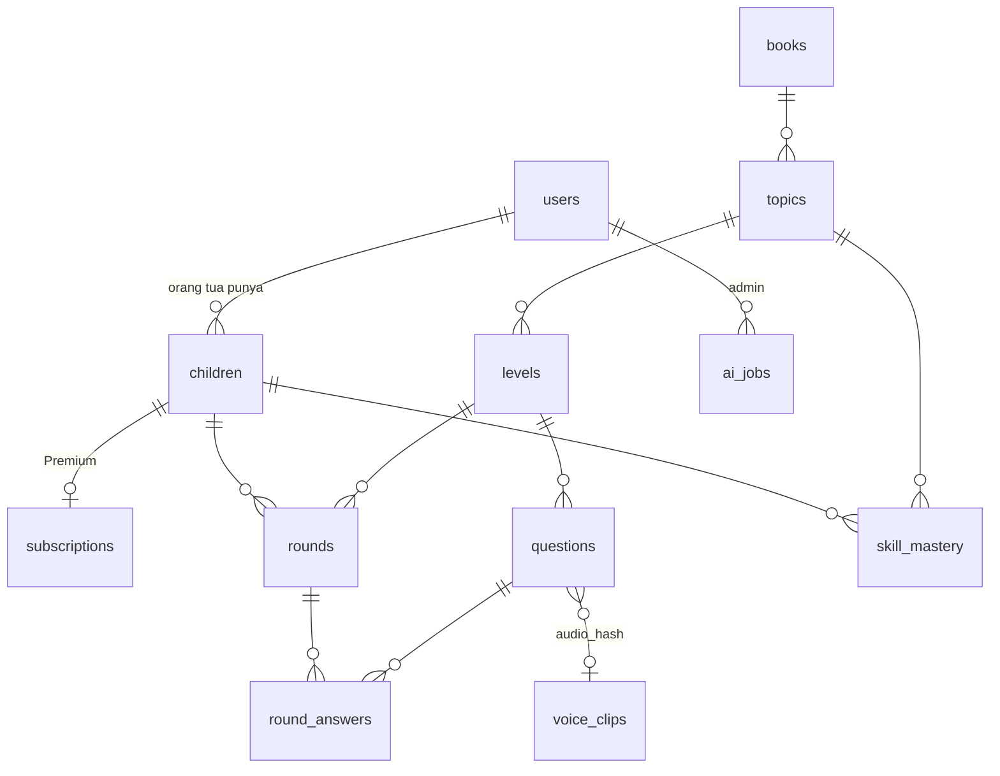

# PRD: UdaKids

Versi 1.0 (rilis pertama) · 13 Oktober 2026 · Penyusun: Ridho Dwi Syahputra

Catatan penamaan: produk ini bernama UdaKids. Platform UdaKids buatan Udacoding yang menjadi acuan disebut "UdaKids asli"
atau "repo referensi" di seluruh dokumen. Nama produk dan maskot ditulis sekali di `apps/web/src/config/app.ts`
(`APP_NAME`, `CHARACTER_NAME`).

## 1. Ringkasan

UdaKids adalah aplikasi web belajar untuk anak SD kelas awal. Anak berlatih soal Matematika dan Sains per topik dan
per level, ditemani robot kecil bernama Momo yang membacakan soal. Orang tua membuat profil anak, memantau laporan,
dan melihat status paket. Admin mengelola konten soal (termasuk membuat draf soal dengan AI yang wajib ditinjau
sebelum tayang), pengguna, dan akses Premium. Papan peringkat hanya menampilkan nama panggilan.

Rilis 1.0 berfokus pada **Kelas 1** (Matematika dan Sains: 8 topik, 24 level, 240 soal) dengan tiga peran yang saling
terhubung penuh: anak, orang tua, dan admin. Arsitekturnya mengikuti platform UdaKids asli milik Udacoding: monorepo pnpm,
React + Vite, NestJS, Drizzle, PostgreSQL, dan paket `engine` bersama yang dipakai web dan server. Dengan fondasi ini,
jenjang, mapel, dan fitur berikutnya (bagian 5) bisa ditambahkan tanpa membongkar yang sudah ada.

## 2. Target User

- Siapa: anak usia 5 sampai 8 tahun (Kelas 1 SD) yang belum lancar membaca, dan orang tuanya.
- Jenis user:
  - **Anak:** bermain ronde latihan, melihat tanaman dan peringkat. Tidak punya email dan tidak punya kata sandi
    tertulis. Akun anak dibuat oleh orang tua.
  - **Orang tua:** mendaftar, membuat profil anak, memantau laporan, melihat paket.
  - **Admin:** staf yang mengelola konten, pengguna, dan Premium. Akun admin pertama dibuat oleh seed, bukan pendaftaran.
  - **Pengunjung:** melihat landing dan 10 besar peringkat.

## 3. Masalah yang Diselesaikan

- Anak kelas 1 belum lancar membaca, sedangkan banyak platform soal memakai teks panjang, iklan, dan kata "salah" yang
  membuat anak enggan mencoba.
- Orang tua tidak tahu anaknya kuat atau lemah di topik mana.
- Menambah soal secara manual lambat, padahal setiap soal tetap harus dicek manusia sebelum tayang.
- Akses level berbayar harus terkendali tanpa payment gateway (transfer manual, admin yang mengaktifkan).

## 4. Fitur Rilis 1.0 (8 fitur inti)

| No | Fitur                 | Penjelasan singkat                                                                                                                         |
| -- | --------------------- | ------------------------------------------------------------------------------------------------------------------------------------------ |
| 1  | Akun dan tiga peran   | Orang tua daftar (email + kata sandi, wajib centang persetujuan) dan mendapat kode keluarga 6 huruf. Orang tua membuat maksimal 3 profil anak (nama panggilan, warna Momo, sandi 3 gambar). Anak masuk dengan kode keluarga + sandi gambar. Admin masuk lewat halaman staf. |
| 2  | Belajar terstruktur   | Buku Matematika Kelas 1 dan Sains Kelas 1. Tiap buku berisi 4 topik (A sampai D), tiap topik punya materi singkat dan 3 level. Level berurutan: level 2 terbuka setelah level 1 lulus. Level 1 gratis, level 2 dan 3 Premium. |
| 3  | Ronde latihan         | 5 soal acak dari bank level. Tiga jenis soal: pilihan ganda, isian angka, benar/belum tepat. Soal dibacakan, ada stopwatch tanpa batas waktu, umpan balik hijau/kuning dengan petunjuk, dan halaman hasil (skor, benar, waktu, pujian usaha). **Dinilai di server.** |
| 4  | Skor Jago dan tanaman | Skor penguasaan per topik (0 sampai 100), diperbarui tiap jawaban. Anak hanya melihat tanaman 4 tahap (benih, tunas, pohon, berbuah). Orang tua dan admin melihat angka dan status (Belajar, Bisa, Jago). |
| 5  | Papan peringkat       | Total dan per buku. Hanya nama panggilan dan warna Momo yang terlihat. Posisi anak sendiri disorot. 10 besar tampil di landing.             |
| 6  | Laporan orang tua     | Beranda dengan ringkasan minggu ini, laporan per anak (Skor Jago per topik, ketepatan, 5 ronde terakhir, 3 saran topik), halaman paket dengan tombol WhatsApp ke admin. |
| 7  | Panel admin           | Ringkasan angka, kelola buku/topik/level, bank soal (tambah, ubah, arsipkan), AI pembuat soal (Gemini) dengan tinjauan sebelum tayang, daftar pengguna, aktifkan/cabut Premium, laporan anak dan statistik level. |
| 8  | Suara soal            | Soal dan materi dibacakan dengan Google Cloud Text-to-Speech (Chirp 3 HD, `id-ID-Chirp3-HD-Leda`). Klip dibuat sekali, disimpan di PostgreSQL, diputar otomatis. Bila klip tidak ada, Momo diam dan teks tetap tampil (tanpa suara bawaan browser). |

### 4.1 Aturan nilai ()

- **Ronde:** 5 soal, tiap soal dinilai sekali. Skor = benar / 5 × 100. Lulus bila skor ≥ 70 **dan** keliru ≤ 3 (aturan
  UdaKids asli). Ambang, jumlah soal per ronde, dan batas keliru disimpan per level.
- **Level:** berurutan di dalam topik. Topik boleh dipilih bebas. Level terbuka bila bernomor 1 atau level sebelumnya
  pernah lulus.
- **Premium:** level dengan `is_free = false` hanya bisa dimainkan bila anak punya langganan aktif. Dicek di server.
- **Skor Jago:** tahap tanaman yang sudah terlihat tidak pernah turun. Kekeliruan di mode tantangan tidak menghukum.
- **Peringkat:** total skor = jumlah skor terbaik tiap level. Seri dipecah dengan total waktu lebih cepat.

### 4.2 Interaksi antar peran

1. Orang tua mendaftar, membuat profil anak dan sandi gambar, lalu mendapat kode keluarga.
2. Anak masuk dengan kode keluarga dan sandi gambar itu, lalu bermain.
3. Setiap ronde tersimpan, sehingga laporan orang tua, Skor Jago, papan peringkat, dan statistik admin ikut berubah.
4. Admin menambah soal (manual atau AI). Setelah disetujui, soal langsung muncul di ronde anak berikutnya.
5. Admin mengaktifkan Premium untuk seorang anak. Level 2 dan 3 langsung terbuka di area anak, dan status paket di area
   orang tua berubah.

## 5. Peta Jalan (setelah rilis 1.0)

Hal berikut **tidak** dibangun di rilis 1.0. Struktur data dan modul disiapkan agar bisa ditambah nanti.

- Jenjang lain (PAUD, TK, Kelas 2 sampai 6, olimpiade) dan mapel lain (literasi).
- Generator soal berbasis parameter (family generator di `engine`), mock test, dan buku 10 level per topik.
- Petualangan Momo (puzzle kartu perintah), lab, simulasi, dan game.
- Payment gateway, afiliasi, buku kas, komisi. Di rilis 1.0 Premium diaktifkan admin.
- Fasilitator, kelas, dan lomba live.
- Login Google, verifikasi email, lupa kata sandi, email transaksi (Nodemailer).
- Mode offline/PWA dan antrean sinkronisasi (outbox).
- Data realtime (SSE dan polling). Rilis 1.0 memuat peringkat saat halaman dibuka.
- Foto nyata (Pexels) dan penyaringan foto dengan AI.
- Hias Momo lengkap (aksesori). Rilis 1.0 cukup pilih warna.
- Hapus akun orang tua secara mandiri (hapus profil anak sudah ada).

## 6. Alur User

### Orang tua

1. Buka landing `/`, klik "Daftar sebagai orang tua", isi nama, email, kata sandi (min 8), centang persetujuan data nama
   panggilan anak. Setelah daftar langsung masuk ke beranda dan kode keluarga tampil.
2. Klik "Tambah anak": nama panggilan (2 sampai 20 huruf), warna Momo (6 pilihan). Lalu atur sandi gambar: pilih 3 gambar
   berurutan dari 9 gambar, ulangi untuk konfirmasi.
3. Beri tahu anak kode keluarga (ada tombol Salin). Anak bermain di `/play/masuk`.
4. Kembali ke beranda: lihat ringkasan minggu ini dan kartu progres per anak. Buka laporan anak untuk Skor Jago per topik,
   ketepatan, ronde terakhir, dan 3 saran topik.
5. Buka Paket: lihat Free/Premium dan masa berlaku per anak. Untuk upgrade klik "Hubungi admin" (WhatsApp dengan teks
   otomatis berisi nama orang tua dan nama panggilan anak), transfer manual, lalu admin mengaktifkan.

### Anak

1. Buka `/play/masuk`, ketik kode keluarga 6 huruf, pilih kartu profil (nama + Momo), ketuk 3 gambar sandi.
2. Beranda: dua buku dan tombol "Lanjutkan" ke level terakhir. Buka buku, lihat topik dengan tanaman masing-masing.
3. Buka topik: dengarkan materi singkat, lalu pilih level. Level punya 5 keadaan: lulus, terbuka, terkunci (level
   sebelumnya belum lulus), Premium ("Minta orang tua membuka level ini", tanpa harga), dan segera hadir (soal belum cukup).
4. Main ronde: 5 soal, tiap soal dibacakan otomatis. Jawab, lihat umpan balik hijau atau kuning dengan petunjuk, ketuk
   "Lanjut".
5. Halaman hasil: skor, "4 dari 5 benar", waktu, pujian usaha. Lulus: tombol "Lanjut level berikutnya". Belum lulus:
   "Coba lagi" dengan soal diacak ulang.
6. Lihat papan peringkat dan profil (tanaman, riwayat, ganti warna Momo).

### Admin

1. Masuk di `/masuk/staf`. Lihat ringkasan: jumlah orang tua, anak, ronde hari ini, anak aktif 7 hari, topik paling sulit.
2. Konten: atur buku, topik (judul + materi), level (judul, gratis/Premium).
3. Bank soal: filter per level dan status, tambah/ubah/arsipkan manual.
4. AI pembuat soal: pilih level, jumlah (5 sampai 20), jenis, catatan. Gemini membuat draf, divalidasi, lalu admin meninjau,
   mengubah, dan menyetujui. Saat disetujui, suara dibuat sekali.
5. Pengguna: cari orang tua dan anak, aktifkan Premium dengan tanggal berakhir, atau cabut.
6. Laporan: laporan anak (sama dengan versi orang tua) dan statistik per level (tingkat lulus, rata-rata skor).

## 7. Daftar Halaman

Router: React Router 6. Bagian dinamis ditulis `:param`. URL halaman berbahasa Indonesia, semua teks UI lewat i18n.

| Halaman           | URL                          | Isi                                                                               | Perlu login? |
| ----------------- | ---------------------------- | --------------------------------------------------------------------------------- | ------------ |
| Landing           | `/`                          | Penjelasan singkat, 10 besar peringkat, tombol "Anak masuk", "Orang tua", "Staf"  | Tidak        |
| Gaya (dev)        | `/gaya`                      | Katalog token dan komponen. Hanya ada saat `import.meta.env.DEV`                  | Tidak        |
| Masuk anak        | `/play/masuk`                | Kode keluarga, pilih profil, sandi gambar                                         | Tidak        |
| Beranda anak      | `/play`                      | Rak buku, tombol Lanjutkan                                                        | Anak         |
| Buku              | `/play/buku/:slug`           | Daftar topik dengan tanaman                                                       | Anak         |
| Topik             | `/play/topik/:id`            | Materi singkat (dibacakan) dan 3 kartu level                                      | Anak         |
| Ronde             | `/play/main/:levelId`        | Pemain soal                                                                       | Anak         |
| Hasil             | `/play/hasil/:roundId`       | Skor, benar, waktu, pujian, tombol lanjut atau coba lagi                          | Anak         |
| Peringkat anak    | `/play/peringkat`            | Tab Total dan per buku, sorot diri sendiri                                        | Anak         |
| Profil anak       | `/play/profil`               | Tanaman, 10 ronde terakhir, ganti warna Momo, Keluar                              | Anak         |
| Daftar orang tua  | `/orang-tua/daftar`          | Nama, email, kata sandi, centang persetujuan                                      | Tidak        |
| Masuk orang tua   | `/orang-tua/masuk`           | Email + kata sandi                                                                | Tidak        |
| Beranda orang tua | `/orang-tua`                 | Kode keluarga + Salin, ringkasan minggu, kartu anak                               | Orang tua    |
| Tambah anak       | `/orang-tua/anak/baru`       | Nama panggilan, warna Momo, lalu sandi gambar                                     | Orang tua    |
| Laporan anak      | `/orang-tua/anak/:id`        | Skor Jago per topik, ketepatan, ronde terakhir, 3 saran                           | Orang tua    |
| Ubah anak         | `/orang-tua/anak/:id/ubah`   | Ubah nama/warna, hapus anak (konfirmasi mengetik nama)                            | Orang tua    |
| Sandi gambar      | `/orang-tua/anak/:id/sandi`  | Atur ulang sandi 3 gambar                                                         | Orang tua    |
| Paket             | `/orang-tua/paket`           | Status per anak, tombol WhatsApp admin                                            | Orang tua    |
| Masuk staf        | `/masuk/staf`                | Email + kata sandi admin                                                          | Tidak        |
| Ringkasan admin   | `/admin`                     | Kartu angka dan tabel topik tersulit                                              | Admin        |
| Konten            | `/admin/konten`              | Buku, topik, level, toggle gratis/Premium                                         | Admin        |
| Bank soal         | `/admin/soal`                | Tabel soal, filter level dan status, form tambah/ubah                             | Admin        |
| AI pembuat soal   | `/admin/soal/ai`             | Form permintaan, tabel tinjauan draf, tombol setujui                              | Admin        |
| Pengguna          | `/admin/pengguna`            | Orang tua dan anak, cari, dialog Premium                                          | Admin        |
| Laporan admin     | `/admin/laporan`             | Laporan anak dan statistik level                                                  | Admin        |
| 404               | `*`                          | Halaman tidak ditemukan dengan tombol kembali (nada ramah anak)                   | Tidak        |

Pengalihan: `/play/*` tanpa sesi anak ke `/play/masuk`. `/orang-tua/*` tanpa sesi orang tua ke `/orang-tua/masuk`.
`/admin/*` tanpa sesi admin ke `/masuk/staf`. Sesi dengan peran lain dialihkan ke beranda perannya.

## 8. Panduan Tampilan

- **Kesan:** hangat, jelas, dan tenang. Area anak besar dan bersahabat. Area orang tua dan admin lebih rapat, seperti alat
  kerja. Arah desain bebas dieksplorasi di M1 lewat halaman `/gaya`; setelah dikunci, warna hanya dipakai lewat token.
  Design system UdaKids asli (salinannya ada di  setelah M0) menjadi acuan prinsip,
  bukan untuk disalin mentah: proyek ini punya identitas visual sendiri.
- **Tanpa framework UI.** CSS biasa dengan token sendiri: `apps/web/src/styles/uk-tokens.css` dan `uk-components.css`,
  kelas berawalan `uk-` (contoh `uk-btn`, `uk-card`). Awalan ini sama dengan repo referensi karena nama produknya sama;
  nilai token dan kodenya ditulis sendiri. Ikon berupa komponen SVG sendiri (tanpa emoji, tanpa pustaka ikon).
- **Token warna awal** (jangan menaruh hex baru di komponen):

  | Token                          | Nilai                 | Dipakai untuk                                                                  |
  | ------------------------------ | --------------------- | ------------------------------------------------------------------------------ |
  | `--uk-bg`                      | `#FFF8EE`             | Latar halaman (krem hangat)                                                    |
  | `--uk-surface`                 | `#FFFFFF`             | Kartu, panel                                                                   |
  | `--uk-text` / `--uk-text-muted`| `#23302B` / `#5B6B63` | Teks utama dan sekunder                                                        |
  | `--uk-border`                  | `#E7DCC8`             | Garis dan bingkai                                                              |
  | `--uk-primary` / `-hover`      | `#1F6FB2` / `#185A91` | Tombol utama, tautan, menu aktif (teks putih, kontras 5,2:1)                   |
  | `--uk-primary-soft`            | `#E3F0FA`             | Latar sorotan                                                                  |
  | `--uk-correct` / `-soft`       | `#2F9E63` / `#E2F5EA` | Jawaban tepat: bingkai dan ikon hijau, latar lembut, teks tetap `--uk-text`    |
  | `--uk-retry` / `-soft`         | `#F2B705` / `#FFF4CC` | Jawaban belum tepat: bingkai dan ikon kuning, latar lembut                     |
  | `--uk-danger`                  | `#C0392B`             | **Hanya area orang tua dan admin** untuk tindakan hapus. Tidak pernah untuk jawaban anak |

  Warna Momo (6 pilihan, tanpa ungu dan tanpa merah): `blue #3B82C4`, `green #3FA66B`, `yellow #F2B705`,
  `orange #F08A24`, `pink #EC7FA8`, `teal #2AA5A0`.
- **Font:** Andika untuk isi (dirancang untuk pembaca pemula) dan Baloo 2 untuk judul, dipasang lokal lewat `@fontsource`.
  Area anak: isi 20 sampai 24 px, soal 28 sampai 32 px. Area dewasa: 14 sampai 16 px.
- **Komponen anak:** `BigButton`, `BigCard`, `Momo` (robot SVG buatan sendiri, 6 warna lewat CSS variable, 3 ekspresi:
  biasa, senang, menyemangati), `Plant` (4 tahap SVG), `ListenButton`, `AnswerOptions`, `Keypad`, `PicturePin` (grid 3 × 3,
  9 gambar SVG), `CountObjects` (gambar objek untuk soal hitung), `RoundProgress`, `Stopwatch`.
- **Komponen dewasa:** `DataTable`, `FormField`, `Dialog`, `Tabs`, `Badge`, `Toast`, `StatCard`, `Sidebar`, `ConfirmDelete`.
- **Tata letak:**
  - **Anak:** bilah atas tipis (Momo kecil + nama panggilan). Navigasi bawah 3 tombol besar (Belajar, Peringkat, Profil),
    masing-masing ≥ 64 px. Konten maksimal 960 px, di tengah.
  - **Orang tua dan admin (desktop):** sidebar kiri, konten kanan. Di ponsel sidebar menjadi menu geser. Sidebar admin
    berlatar `--uk-text` dengan label "Admin" agar jelas beda dari area orang tua.
- **Halaman ronde:** bilah progres "2 dari 5" dan stopwatch kecil di atas. Kartu soal besar dengan tombol dengar di pojok
  kanan atas (64 px) dan `CountObjects` bila ada. Pilihan jawaban berupa grid 2 × 2 tombol besar (tinggi ≥ 96 px). Isian
  angka memakai `Keypad` 0 sampai 9, hapus, dan "Periksa". Setelah menjawab, panel umpan balik naik dari bawah: hijau
  ("Tepat! Kamu teliti menghitung.") atau kuning ("Belum tepat." + petunjuk), dengan tombol "Lanjut" ≥ 64 px. Momo bereaksi
  dengan animasi CSS keyframes dan menghormati `prefers-reduced-motion`.
- **Aturan UX anak (wajib, diperiksa dengan skill `/child-ux-review`):**
  - Target sentuh minimal 64 × 64 px dan semuanya bisa dioperasikan dengan mouse saja.
  - Setiap soal dan instruksi punya tombol dengar, diputar otomatis saat muncul. Audio gagal: diam, teks tetap tampil.
  - Tidak ada kata "salah" atau "gagal". Pakai "Belum tepat" dengan petunjuk. Untuk soal benar/salah, pilihan kedua ditulis
    "Belum tepat".
  - Jawaban keliru tidak berwarna merah. Benar hijau, belum tepat kuning.
  - Pujian menyebut usaha ("Kamu teliti menghitung!"), bukan kepintaran ("Kamu pintar!").
  - Tidak ada nyawa, streak, atau hitung mundur. Stopwatch tanpa batas boleh.
  - Tidak ada harga, iklan, tautan keluar, atau chat AI di area anak. Level Premium menampilkan "Minta orang tua membuka
    level ini".
  - Kalimat untuk anak maksimal 15 kata.
  - Data anak hanya nama panggilan, warna Momo, dan hash sandi gambar. Tanpa foto, email, tanggal lahir, gender.
- **Keadaan tiap halaman:** loading (kerangka abu), kosong (pesan ramah + tindakan berikutnya), error (pesan jelas + tombol
  "Coba lagi"). Toast hanya di area dewasa.
- **Responsif dan aksesibilitas:** cek di lebar 1280 px dan 390 px. Fokus keyboard terlihat, kontras teks ≥ 4,5:1, gambar
  bermakna punya teks alternatif, tombol ikon punya `aria-label`.

## 9. Struktur Database (PostgreSQL, Drizzle ORM)

**Semua identifier kode, tabel, kolom, URL API, dan field JSON memakai bahasa Inggris** (`snake_case` di database,
`camelCase` di JSON), seperti repo UdaKids asli. Teks yang dilihat pengguna berbahasa Indonesia lewat i18n. Skema hanya di
`apps/api/src/db/schema.ts`, migrasi dibuat `pnpm db:generate` ke `apps/api/drizzle/`. Semua waktu `timestamptz`.

### Daftar nilai

- Peran akun (`users.role`): `admin`, `parent`. Token anak berperan `child` (anak tidak punya baris di `users`).
- Jenis soal (`questions.type`): `choice` (pilihan ganda 4 opsi), `number` (isian angka), `true_false` (opsi "Benar" dan
  "Belum tepat").
- Status soal: `draft`, `active`, `archived`. Sumber soal: `manual`, `ai`, `seed`.
- Status level untuk anak (dihitung server, tidak disimpan): `passed`, `open`, `locked`, `premium`, `soon`.
- Status penguasaan untuk orang tua: `learning` (Belajar), `proficient` (Bisa), `mastered` (Jago).
- Warna Momo: `blue`, `green`, `yellow`, `orange`, `pink`, `teal`.
- Gambar sandi (9): `apple`, `star`, `fish`, `flower`, `ball`, `cat`, `house`, `cloud`, `leaf`.
- Tahap tanaman (`skill_mastery.visible_stage`): 0 benih, 1 tunas, 2 pohon, 3 berbuah.
- Objek hitung (`questions.visual.item`): `apple`, `ball`, `star`, `fish`, `leaf`, `book`.
- Paket anak: `free`, `premium`.

### Tabel `users`: akun dewasa

| Kolom         | Tipe        | Keterangan                                                                   |
| ------------- | ----------- | ---------------------------------------------------------------------------- |
| id            | uuid        | primary key, default `gen_random_uuid()`                                     |
| role          | text        | `admin` atau `parent`                                                        |
| name          | text        | wajib, maks 60 karakter                                                      |
| email         | text        | maks 254 karakter; indeks unik pada `lower(email)`                           |
| password_hash | text        | `scrypt` Node crypto dengan salt acak                                        |
| family_code   | text        | unik, 6 huruf A sampai Z tanpa `I` dan `O`; hanya orang tua                   |
| consent_at    | timestamptz | waktu centang persetujuan; wajib untuk orang tua                             |
| created_at    | timestamptz | default `now()`                                                              |

### Tabel `children`: profil anak (data seminimal mungkin)

| Kolom           | Tipe        | Keterangan                                                                     |
| --------------- | ----------- | ------------------------------------------------------------------------------ |
| id              | uuid        | primary key                                                                    |
| parent_id       | uuid        | referensi `users.id`, `on delete cascade`                                      |
| nickname        | text        | 2 sampai 20 karakter; unik per orang tua pada `lower(nickname)`                |
| momo_color      | text        | salah satu dari 6 warna Momo                                                   |
| pin_hash        | text        | hash `scrypt` dari `"gambar1-gambar2-gambar3"`; kosong = sandi belum diatur     |
| failed_attempts | integer     | default 0; naik tiap sandi keliru, kembali 0 saat berhasil                     |
| locked_until    | timestamptz | diisi saat `failed_attempts` mencapai 5 (kunci 1 menit)                        |
| last_active_at  | timestamptz | diperbarui saat ronde selesai                                                  |
| created_at      | timestamptz | default `now()`                                                                |

### Tabel `subscriptions`: Premium per anak (hanya admin yang mengubah)

| Kolom      | Tipe        | Keterangan                                                |
| ---------- | ----------- | --------------------------------------------------------- |
| child_id   | uuid        | primary key, referensi `children.id`, `on delete cascade` |
| ends_at    | timestamptz | tanggal berakhir                                          |
| set_by     | uuid        | referensi `users.id` (admin)                              |
| updated_at | timestamptz | default `now()`                                           |

Paket efektif anak: `premium` bila ada baris dengan `ends_at > now()`, selain itu `free`.

### Tabel konten: `books`, `topics`, `levels`

| Tabel  | Kolom (selain `id uuid pk`)                                                                                                                                                    |
| ------ | ------------------------------------------------------------------------------------------------------------------------------------------------------------------------------ |
| books  | `slug` text unik (`matematika-kelas-1`), `grade` text (`kelas-1`), `subject` text (`math`/`science`), `title` text, `sort` int                                                    |
| topics | `book_id` fk cascade, `code` text (`A` sampai `D`), `title` text, `lesson` text (materi singkat), `lesson_audio_hash` text boleh kosong, `sort` int; unik (`book_id`, `code`)     |
| levels | `topic_id` fk cascade, `number` int 1 sampai 10, `title` text, `is_free` boolean default false, `questions_per_round` int default 5, `pass_score` int default 70, `max_wrong` int default 3; unik (`topic_id`, `number`) |

### Tabel `questions`: bank soal

| Kolom        | Tipe        | Keterangan                                                                                              |
| ------------ | ----------- | ------------------------------------------------------------------------------------------------------- |
| id           | uuid        | primary key                                                                                             |
| level_id     | uuid        | referensi `levels.id`, `on delete cascade`                                                              |
| type         | text        | `choice`, `number`, `true_false`                                                                        |
| prompt       | text        | kalimat soal, maks 200 karakter, maks 15 kata per kalimat                                               |
| visual       | jsonb       | boleh kosong; contoh `{"item":"apple","count":7}` atau `{"item":"apple","groups":[7,5]}`                |
| options      | jsonb       | array teks untuk `choice` (4 opsi) dan `true_false` (`["Benar","Belum tepat"]`); kosong untuk `number`  |
| answer       | text        | jawaban tunggal; **tidak pernah dikirim ke endpoint anak sebelum dijawab**                              |
| explanation  | text        | petunjuk saat belum tepat                                                                               |
| audio_hash   | text        | referensi `voice_clips.hash`, kosong bila suara belum dibuat                                            |
| status       | text        | default `draft`; hanya `active` yang bisa muncul di ronde                                               |
| source       | text        | `manual`, `ai`, `seed`                                                                                  |
| seed_key     | text        | unik, boleh kosong; kunci stabil untuk soal dari `content/` (contoh `1-MA-A-L1-03`)                     |
| seed_version | integer     | versi isi dari `content/`; seed hanya menimpa bila versi naik (suntingan admin aman)                     |
| created_by   | uuid        | referensi `users.id`, kosong untuk seed                                                                 |
| created_at   | timestamptz | default `now()`                                                                                         |

Indeks: (`level_id`, `status`).

### Tabel aktivitas: `rounds`, `round_answers`, `skill_mastery`

| Tabel         | Kolom                                                                                                                                                                                          |
| ------------- | ---------------------------------------------------------------------------------------------------------------------------------------------------------------------------------------------- |
| rounds        | `id` uuid pk, `child_id` fk cascade, `level_id` fk, `question_ids` uuid[] (urutan soal), `started_at` default now, `finished_at` kosong = belum selesai, `correct` int, `wrong` int, `score` int, `passed` boolean, `duration_ms` int. Indeks (`child_id`, `finished_at`) |
| round_answers | `round_id` fk cascade, `question_id` fk, `chosen` text, `is_correct` boolean, `answered_at` timestamptz; primary key (`round_id`, `question_id`) sehingga satu soal dinilai sekali              |
| skill_mastery | `child_id` fk cascade, `topic_id` fk cascade, `score` int default 0, `visible_stage` int default 0, `challenge_correct` int default 0, `updated_at`; primary key (`child_id`, `topic_id`)       |

### Tabel `voice_clips` dan `ai_jobs`

| Tabel       | Kolom                                                                                                                                                                         |
| ----------- | ----------------------------------------------------------------------------------------------------------------------------------------------------------------------------- |
| voice_clips | `hash` text pk (`sha256(teks + "\|" + suara)`), `text` text, `voice` text, `mime` text default `audio/mpeg`, `data` bytea, `bytes` int, `created_at`. Klip MP3 disimpan di PostgreSQL seperti UdaKids asli, jadi cadangan cukup satu `pg_dump` |
| ai_jobs     | `id` uuid pk, `admin_id` fk `users`, `level_id` fk, `requested` int, `accepted` int default 0, `rejected` jsonb (daftar alasan), `model` text, `created_at`                       |

### Isi awal (seed)

Konten ada di `content/` (JSON, ). `pnpm db:seed` memasukkan 2 buku, 8 topik, 24 level, dan soal
yang ada, dengan aturan `seed_key`/`seed_version`. Seed juga membuat admin pertama dari `ADMIN_EMAIL` dan `ADMIN_PASSWORD`
bila belum ada admin (pola yang sama dengan UdaKids asli).

## 10. Aturan Keamanan (Guard dan Peran)

Browser tidak pernah mengakses database. **Semua akses data lewat API NestJS**, dan aturan ditegakkan di API.

- **Autentikasi:** JWT (`@nestjs/jwt`) lewat `Authorization: Bearer <token>`. Isi token: `sub`, `role`
  (`parent`/`admin`/`child`), dan untuk anak juga `parentId`. Berlaku 7 hari. API menolak start bila `JWT_SECRET` kosong
  atau kurang dari 32 karakter.
- **Guard global:** semua rute dijaga. Rute terbuka wajib `@Public()`, pembatasan peran memakai `@Roles(...)`. Guard
  memeriksa akun di database (bukan hanya isi token), sehingga akun yang dihapus langsung kehilangan akses.
- **Kepemilikan data:**
  - Anak: identitas selalu dari token. Tidak ada endpoint anak yang menerima `childId` dari klien.
  - Orang tua: setiap `/parent/children/:id/*` memeriksa `children.parent_id = sub`. Anak milik orang lain dijawab 404.
  - Admin: boleh membaca dan mengubah semua.
- **Kunci jawaban:** `answer` dan `explanation` tidak pernah ada di respons pembuka ronde. Petunjuk dan jawaban tepat
  dikirim hanya sebagai respons setelah anak menjawab soal itu.
- **Penilaian, urutan level, dan Premium** dicek di server saat ronde dibuka dan saat menjawab. Level yang tidak boleh
  dimainkan dijawab 403.
- **Kata sandi dan sandi gambar:** hash `scrypt` dengan salt acak, dibandingkan dengan `timingSafeEqual`. Sandi gambar
  keliru 5 kali mengunci anak itu 1 menit. Login, pencarian kode keluarga, dan pendaftaran dibatasi laju per IP
  (`@nestjs/throttler`).
- **Validasi:** semua body dan query divalidasi Zod (skema dari `engine`). Tidak memakai `eval` atau `new Function`.
- **Rahasia:** `JWT_SECRET`, `DATABASE_URL`, `GEMINI_API_KEY`, `GOOGLE_TTS_API_KEY` hanya di `.env` server, tidak pernah
  berawalan `VITE_`. Kunci TTS memakai Google Cloud, bukan kunci Google AI Studio.
- **Header:** API mengirim `X-Content-Type-Options: nosniff`, `X-Frame-Options: DENY`, tanpa `X-Powered-By`. CORS hanya ke
  `WEB_ORIGIN`.
- **Soal AI:** draf tidak pernah tampil ke anak sebelum admin menyetujui.
- **Papan peringkat:** respons hanya berisi peringkat, nama panggilan, warna Momo, skor, dan penanda "ini kamu". Tanpa id.
- **Suara:** `GET /voice/:hash` publik karena hanya membaca klip berdasarkan hash dan tidak memuat kunci jawaban. Pembuatan
  klip baru dibatasi `TTS_DAILY_LIMIT` per hari.
- **Penghapusan:** menghapus anak menghapus ronde, jawaban, penguasaan, dan langganannya (cascade).
- **Log:** tidak mencatat kata sandi, token, atau sandi gambar.

Penting: aturan paket, urutan level, kepemilikan, dan kunci jawaban wajib punya test e2e (M7 sampai M9), bukan hanya
disembunyikan di tampilan.

## 11. Stack

Ringkasan di bawah; rincian versi, struktur folder, variabel lingkungan, dan perintah ada di
dokumen proyek.

| Lapisan  | Pilihan                                                                                                     |
| -------- | ----------------------------------------------------------------------------------------------------------- |
| Monorepo | pnpm workspaces: `packages/engine`, `apps/web`, `apps/api` (tanpa Turborepo), TypeScript strict             |
| Web      | React 18 + Vite 7 + React Router 6.30 + Zustand 5, CSS dengan token sendiri, i18n JSON, `<audio>` bawaan    |
| API      | NestJS 11 (Express), Drizzle ORM + `pg`, PostgreSQL, Zod 4, JWT + `scrypt`, `@nestjs/throttler`              |
| Engine   | TypeScript murni + Zod 4: skema, penilaian, Skor Jago, peringkat, RNG ber-seed, validasi soal               |
| Layanan  | Google Gemini (draf soal), Google Cloud TTS Chirp 3 HD (suara)                                              |
| Test     | Vitest (engine coverage ≥ 90%), Testing Library + jsdom, Supertest + `unplugin-swc`                          |

## 12. Panduan Kerja untuk Claude Code

Aturan lengkap ada di [CLAUDE.md](CLAUDE.md). Intinya: satu milestone per sesi (skill `/milestone`), tanya dulu sebelum
keputusan di luar PRD lalu catat di , dan milestone selesai hanya bila
`pnpm lint && pnpm typecheck && pnpm test && pnpm validate:content && pnpm build` hijau.

## 13. Rencana Build Bertahap

Urutan, jadwal, isi, dan kriteria tiap milestone ada di dokumen proyek. Ringkasnya:

| Minggu | Milestone | Isi                                                                                                     |
| ------ | --------- | ------------------------------------------------------------------------------------------------------- |
| 1      | M0        | Memahami repo UdaKids asli, menyalin dokumen referensi, membuat peta repo (tanpa kode)                        |
| 1      | M1 sampai M5 | Semua tampilan tiga peran dengan data tiruan di browser (mode mock), mengikuti kontrak  |
| 2      | M6 sampai M10 | API NestJS dan database, lalu tiap modul web disambungkan dari mock ke API                            |
| 2      | M11       | Uji, keamanan, deploy, dan skrip demo                                                                   |

## 14. Asumsi

- Nama produk "UdaKids" dan maskot "Momo" ditulis sekali di `config/app.ts`, sehingga bisa diganti tanpa mengubah
  komponen. Momo digambar sendiri sebagai SVG sederhana, bukan salinan aset UdaKids asli.
- **Database: PostgreSQL lewat `DATABASE_URL`.** Rencana awal memakai Postgres milik project Supabase hanya sebagai hosting
  (tanpa Supabase Auth, RLS, Edge Functions, atau SDK Supabase). Postgres lokal atau VPS cukup dengan mengganti
  `DATABASE_URL`. Status: Usulan ( D-003).
- Hosting: web sebagai file statis dan API Node di layanan yang menjalankan proses terus-menerus, atau satu VPS dengan Nginx
  + systemd seperti UdaKids asli. Status: Usulan (D-009).
- Token JWT dikirim lewat header Bearer dan disimpan di `localStorage`, karena web dan API bisa berbeda domain.
- Klip suara disimpan sebagai `bytea` di PostgreSQL. Sekitar 240 klip (5 sampai 10 MB) jauh di bawah batas database gratis.
- Satu soal dinilai sekali. Setelah "Belum tepat", anak melihat petunjuk lalu lanjut. "Coba lagi" ada di tingkat ronde.
- Tidak ada verifikasi email dan lupa kata sandi di rilis 1.0.
- Pembayaran Premium: transfer manual di luar aplikasi, admin yang mengaktifkan. Nomor WhatsApp admin dari `ADMIN_WHATSAPP`.
- Soal dibuat sendiri (manual dan AI), bukan salinan platform lain. Topik mengacu  UdaKids asli
  (kode 1-MA dan 1-SA).
- Nama model Gemini tidak ditulis di PRD karena cepat berubah; dipilih saat M10 dan dicatat di .
- Waktu ditampilkan sesuai zona waktu perangkat (umumnya WIB).
